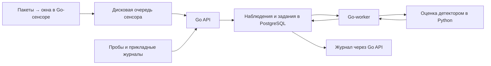

# Целевая архитектура NetWatch

Проектное решение от 19 ноября 2026 года. Контейнеры, команды и условия приёмки ниже задают целевую реализацию. Текущий порядок ручного запуска описан в [инструкции сервера](runbooks/server.md).

## 1. Назначение и границы релиза

NetWatch непрерывно принимает сетевые наблюдения, определяет аномальный интервал и показывает оператору его оценочные начало и конец. Первая серверная версия выпускается для профилей сервисов, по которым детектор прошёл независимую проверку. Определение причины добавляется следующим этапом после приёмки обнаружения.

Go измеряет трафик, доставляет наблюдения, управляет очередями и ведёт журнал инцидентов. Python подготавливает признаки для модели, обучает детекторы и оценивает окна. PostgreSQL хранит окна, задания, прогнозы и инциденты. React показывает журнал через Go API. Пакетные метаданные преобразуются в оконные признаки в Go. Журналы и активные пробы поступают отдельными входами.

Целевое развёртывание — один Linux-сервер с Docker Compose. Сенсор размещается в той точке сети, где виден нужный трафик, включая выделенный наблюдаемый хост при необходимости. Для каждой точки явно указываются интерфейс, фильтр и наблюдаемый сервис. Для восстановления после аварии используется план резервного копирования с проверкой восстановления.

## 2. Контейнеры и локальная сеть

| Служба | Ответственность | Зависимости |
|---|---|---|
| `api` | Go API принимает окна и сводки. Отдаёт собранный React-журнал, историю оценок и состояние конвейера | `db` |
| `worker` | Go-worker забирает задания, вызывает Python, сохраняет результаты и обновляет инциденты | `db`, `ml` |
| `ml` | Python-сервис проверяет фиксированный комплект модели при старте и обслуживает запросы оценки | Комплект модели и контракты |
| `db` | PostgreSQL хранит состояние приложения и очередь. Постоянный том переживает пересоздание контейнера | Постоянное хранилище |
| `migrate` | Одноразовая команда применяет версионированную схему и завершает работу с кодом результата | `db` |
| `sensor` | Go-сенсор захватывает разрешённый трафик, собирает окна, хранит очередь на диске и отправляет данные в API | Точка наблюдения, `api`, постоянная очередь |
| `probe` | Go-проба проверяет доступность явным HTTP-запросом по расписанию и отправляет сводку | Наблюдаемый сервис, `api` |
| `trainer`, `test-runner` | Одноразовые процессы для режимов `train` и `test` | Выделенная среда соответствующего режима |

`api`, `worker`, `ml`, `db` и `migrate` работают в приватной сети Compose. Сервисы обращаются друг к другу по именам, например `db:5432` и `ml:8000`. На сервере публикуется только вход API и интерфейса через HTTPS. PostgreSQL и Python остаются доступны внутри сети. При запуске сенсора на другом узле он обращается к HTTPS API с отдельными учётными данными. Право захвата получает только сенсор в точке наблюдения. [Сеть Docker Compose](https://docs.docker.com/compose/how-tos/networking/)

Исходный код Go API, worker и миграций собирается из одной версии репозитория. API и worker можно запускать из одного серверного Go-образа с разными командами. Сенсор имеет отдельный образ с зависимостями захвата. React собирается в образ API как статические файлы.

## 3. Режимы и команды запуска

Команды в таблице — целевые точки входа с корня репозитория. `Makefile` делегирует работу Compose и штатным CLI, чтобы одна и та же команда работала на сервере и в автоматической проверке.

| Режим | Команда | Что выполняется |
|---|---|---|
| `work` | `make work` | Проверяет серверную конфигурацию, запускает БД и миграции, поднимает API, worker и Python с утверждённой моделью, проверяет готовность |
| `train` | `make train DATASET=… OUTPUT=…` | Запускает одноразовый контейнер, читает зафиксированный манифест и выпускает новый комплект модели и отчёт в заданный каталог |
| `test` | `make test` | Запускает быстрые unit-тесты и проверки контрактов Go, Python и интерфейса |
| `test` | `make test-e2e` | Поднимает собственный экземпляр Compose с тестовой БД и отдельными томами, выполняет путь до журнала |
| `test` | `make test-acceptance` | Запускает полную релизную приёмку с закрытым манифестом, зафиксированным комплектом модели и отчётом |
| `work` | `make work-status`, `make work-logs`, `make work-stop` | Показывает готовность и состояние очередей, читает логи, останавливает рабочие процессы с сохранением томов |

`work` использует `deploy/compose.yaml` и фиксированную серверную конфигурацию. `train` использует одноразовый запуск со своими томами и манифестом. `test` создаёт отдельный Compose-проект с собственной сетью, токенами и БД. Сквозной тест использует те же образы и контракты, что и сервер. В рабочую среду попадает комплект модели, явно выбранный оператором по идентификатору и контрольной сумме. [Профили Docker Compose](https://docs.docker.com/compose/how-tos/profiles/)

## 4. Запуск процессов и логирование

У каждой Go-команды свой `main.go`. Это место сборки зависимостей. Общие загрузчики конфигурации и фабрика логгера находятся в `internal/config` и `internal/telemetry`. Последовательность запуска у команд общая.

1. Загрузить конфигурацию процесса, построить логгер, проверить обязательные параметры и завершиться с понятной ошибкой при неверной настройке. Для ошибки до загрузки логгера предусмотрена запись в stderr.
2. Создать корневой контекст, отменяемый по SIGTERM. Открыть БД или очередь, создать клиентов с тайм-аутами и собрать прикладные компоненты. Передать каждому зависимость и логгер с именем компонента.
3. Запустить приём запросов или рабочий цикл. Отдельно публиковать состояние процесса и готовность его функции.
4. На остановке прекратить приём новых операций, завершить текущие в пределах тайм-аута, сохранить неподтверждённые окна в локальной очереди и закрыть ресурсы.

`migrate` ждёт доступности PostgreSQL. API и worker стартуют после успешных миграций. Python загружает модель независимо. API остаётся доступен для приёма данных при недоступном Python. Итог `make work` проверяет готовность полного стека, в том числе модели, worker и выбранных профилей наблюдения. Каждая служба сама восстанавливает соединения при перезапуске зависимостей. [Порядок запуска и остановки Compose](https://docs.docker.com/compose/how-tos/startup-order/)

Go и Python пишут структурированные JSON-логи в stdout и stderr. Общие поля включают время UTC, уровень, версию, компонент и событие. При обработке данных используются применимые `request_id`, `sensor_id`, `event_id`, `job_id` и `model_id`. Эти поля позволяют проследить одно наблюдение от приёма до оценки в обоих языках. Журналы содержат события запуска, изменения готовности, ошибки, повторы и агрегированные счётчики. Токены, тела запросов, содержимое пакетов и строки подключения исключаются из логов. Docker хранит и ротирует контейнерные логи по настроенному лимиту. [Локальный драйвер логов Docker](https://docs.docker.com/engine/logging/drivers/local/)

Для запуска оператору нужны конфигурация хоста, учётные данные и утверждённый артефакт модели. Репозиторий содержит пример конфигурации с описанием параметров. Секреты подаются через файлы с ограниченным доступом. Повтор запуска с той же конфигурацией поднимает тот же стек и использует существующие тома. Миграции проверяют версию схемы, а модель сверяется с идентификатором, контрольной суммой и профилем.

## 5. Рабочий конвейер и контракты

### Сбор и доставка

Go обрабатывает каждый пакет. Основной поток хранения состоит из окон метрик на сервис, начальный формат — пятисекундные окна. Один и тот же Go-код извлекает признаки из живого трафика и записей для обучения и оценки. Окно содержит время события, идентификатор сенсора и сервиса, версию признаков и качество покрытия. Числовой ноль означает измеренный ноль. Отсутствие измерения передаётся отдельно.

Сенсор записывает готовые окна в дисковую очередь и отправляет ограниченные пачки. API проверяет формат и полномочия источника, затем в одной транзакции сохраняет окно и создаёт задание. Подтверждение возвращается после фиксации транзакции. Повторный запрос с тем же идентификатором и содержимым получает прежний результат. Конфликт содержимого отображается как ошибка. Размер очереди ограничен; потеря окна или пакета отражается в данных о покрытии и в метриках.

Сводки HTTP, входов, DNS, проб и плановых работ сохраняются до оценки с идентификатором источника, временем, охватом и версией политики. Ожидаемые изменения заявляет источник календаря. Сервер объединяет совместимые сводки по нормализованному идентификатору сервиса, интервалу и области наблюдения. Результат ссылается на исходные записи. Так сбой Python оставляет принятые данные в очереди, а оператор может проверить происхождение признака.

### Оценка и инциденты

Go-worker получает задания с ограниченной по времени арендой и передаёт Python версионированный вход. Если модели нужна история, worker подбирает предшествующие окна того же профиля. Python возвращает оценку, версию модели и статус. Go проверяет соответствие задания и результата, сохраняет его и обновляет инцидент. При недоступности модели задания остаются в очереди с повторными попытками. Ошибка формата получает диагностический статус. Истёкшая аренда позволяет другому worker продолжить работу. Запоздавший ответ с истёкшей арендой не меняет состояние.

Версия модели привязывается к профилю сервиса и версии признаков. Штатный результат допустим при достаточном покрытии и пригодном профиле. Остальные состояния интерфейс различает явно. Например, `insufficient_data` для пропущенных измерений, `unsupported_profile` для неизвестного профиля, состояние очереди для недоступного сервиса модели.

На первом этапе модель оценивает факт аномального поведения. Go применяет общую версионированную политику открытия и закрытия интервала. Она учитывает порядок окон и разрывы. Если старое задание задерживается сверх заданного бюджета, журнал показывает разрыв и продолжает обработку; позднее событие сохраняется с отметкой о задержке. Известные оценки границ эпизода и время появления сигнала в журнале хранятся в разных полях. Остановка сбора или пропуск измерений не закрывает инцидент как восстановившийся.

Пакет модели включает идентификатор и контрольную сумму, профиль, схему признаков, параметры преобразования, порог, сведения о данных обучения и отчёт калибровки. Контракты обмена закрепляются в `contracts/`. Данные о причине инцидента появятся после независимой проверки обнаружения. Для подтверждённых типов понадобится независимая разметка причины и пригодные источники.

## 6. Хранение и работа оператора

- PostgreSQL хранит агрегаты, источники прикладных наблюдений, задания, оценки и журнал. Справочник профилей задаёт соответствие сервисов, версий признаков и моделей. Постоянная очередь сенсора хранится отдельным томом или каталогом на хосте точки наблюдения.
- Крупные записи трафика, датасеты, веса, отчёты по отдельным входам и секреты хранятся отдельно. В Git входят код, контракты, небольшие тестовые данные и итоговая сводка.
- Рабочая конфигурация задаёт срок хранения наблюдений, размер очереди и объём логов. Старые данные удаляются по согласованной политике с учётом открытых инцидентов и связей в базе. Резервные копии БД хранятся вне рабочего тома. Инструкция восстановления включает запуск на отдельной БД и проверку содержимого журнала.
- Оператор видит готовность приёма и оценки, возраст старейшей задачи, глубину очереди, повторы, потери захвата и окна без достаточного покрытия. Задержка измеряется отдельно от конца окна до подтверждения API, от приёма до оценки и от оценочного начала эпизода до появления записи в журнале.
- Обновление использует версию образов, схемы, модели и политики. Перед переключением модели обрабатываются задания старой версии либо сохраняется совместимый обработчик до их завершения. Откат проверяется на предыдущей версии образов и совместимой схеме. Миграции получают отдельные полномочия; рабочие процессы используют ограниченный доступ к таблицам.

## 7. Данные, эксперименты и отдельная приёмка

На этапе анализа каталогизируются все доступные источники. Для каждого проверяются происхождение, профиль, разметка, точность временных границ и покрытие признаков. Человек утверждает критерии отбора; скрипт проверяет формат, хеши, дубликаты и пересечения и выпускает манифест с причинами включения или исключения. Деление на обучение, калибровку, валидацию и закрытый тест производится по целым записям, эпизодам и окружениям. Уже разобранные записи остаются в разработке и регрессии. Записи без известных границ используются только для показателей, которые они позволяют измерить.

Сравнение начинается с устойчивого порога или EWMA, Isolation Forest, текущего детектора, CatBoost и MLP. Существующий GRU по ошибке прогноза остаётся кандидатом сравнения. Каждый вариант проходит штатный путь от захвата или импорта до журнала на одинаковых записях. Модели обучаются отдельно, а результат обрабатывается одной политикой инцидентов. Отчёт показывает полноту эпизодов, ложные инциденты за час обычной работы, ошибки начала и конца, дробление и слияние событий, долю оцениваемых интервалов и задержку. Допуски фиксируются до закрытого теста.

Релизная приёмка состоит из четырёх частей.

| Проверка | Что требуется подтвердить |
|---|---|
| Сборка и запуск | Один старт на чистом окружении. БД и миграции готовы, API обслуживает журнал, Python подтверждает версию модели, worker обрабатывает контрольное окно |
| Сквозные сценарии | Обычная нагрузка, размеченный аномальный интервал, начало и конец в журнале, неполное наблюдение, повторная доставка. Путь проверяется для каждого кандидата в изолированной среде |
| Восстановление и нагрузка | Перезапуск, временная недоступность БД или Python, восстановление очереди и журнала из копии. Замер задержки, пропусков и возраста очереди на заданном профиле нагрузки |
| Независимое качество | Утверждённый по валидации кандидат укладывается в допуски на свежем закрытом наборе. Отчёт указывает версию модели, конфигурацию, объём данных и ограничения |

В продуктовый коммит входит прошедший приёмку детектор, штатное развёртывание, нужные проверки и сводка сравнения всех вариантов. Экспериментальные реализации и большие артефакты остаются в локальном хранилище. Сначала принимается обнаружение интервалов. Затем отдельно проверяется классификация причин. Существующий `make test-anomalies` сохраняется как специализированная проверка типов, а единые критерии качества обнаружения описываются отдельно.

## 8. Карта репозитория

| Путь | Что искать |
|---|---|
| `cmd/` | Запуски Go и сборка зависимостей в `main.go` |
| `internal/config/`, `internal/telemetry/` | Конфигурация, общая фабрика логгера, метрики |
| `internal/capture/`, `decode/`, `flow/`, `window/` внутри `internal/` | Захват, декодирование, состояние потоков и оконные признаки |
| `internal/spool/`, `transport/`, `api/` внутри `internal/` | Дисковая очередь, передача пачек и маршруты Go API |
| `internal/store/`, `worker/`, `incidents/` внутри `internal/` | PostgreSQL, выдача заданий, вывод прогноза и жизненный цикл инцидента |
| `ml/netwatch_ml/data/`, `training/`, `models/`, `serving/` | Импорт и признаки для модели, обучение, детекторы, Python API |
| `web/` | React-журнал. Сборка включается в образ API |
| `contracts/`, `migrations/` | Схемы JSON, примеры сообщений и миграции PostgreSQL |
| `deploy/` | Серверный `compose.yaml`, изолированный стенд в `lab/` и команды запуска обучения |
| `tests/`, `ml/tests/` | Сценарии в `tests/integration/` и `tests/e2e/`, фикстуры, тесты Python. Go unit-тесты лежат рядом с кодом |
| `benchmarks/`, `docs/` | Исследовательские сценарии, архитектурные решения, результаты и инструкции эксплуатации |

Перемещение кода делаем вместе с соответствующим этапом, когда оно проясняет ответственность пакета. README остаётся входной точкой для карты проекта, команд и документации.

## 9. Порядок реализации

1. Зафиксировать версии контрактов, собрать инвентаризацию данных и назначить профили. Настроить единый путь запуска и логирования.
2. Собрать рабочий Compose, изолированный стенд тестов и режим обучения. Проверить запуск, сохранность очередей и эксплуатационные команды.
3. Привести минутные наблюдения к надёжному приёму с сохранением происхождения. Измерить задержки по этапам, затем настроить закрытие окон и ожидание в очереди на основе замеров.
4. Сравнить модели обнаружения на единых входах. Проверить каждого кандидата сквозным прогоном, выбрать лучшего на валидации и подтвердить его на закрытом тесте.
5. Зафиксировать результаты и выпустить принятый вариант. После приёмки детектора начать этап классификации.
